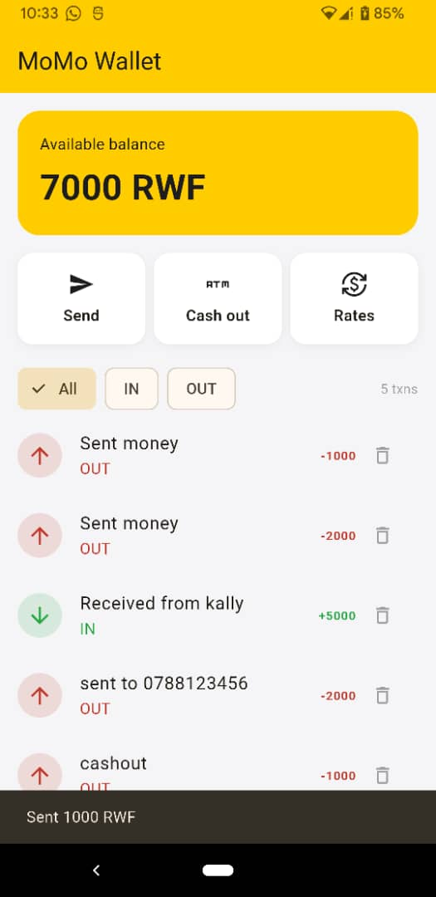
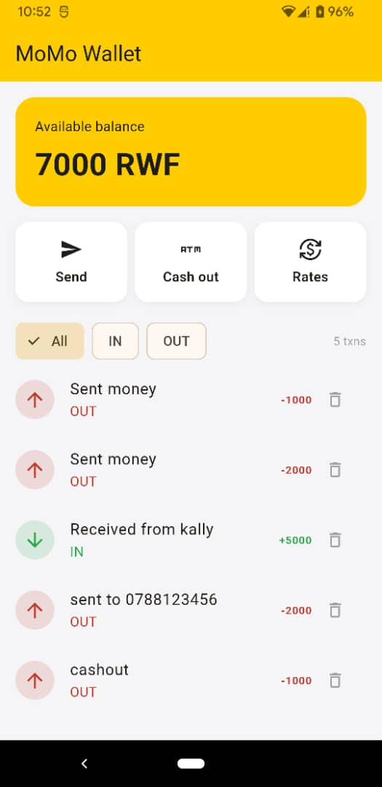
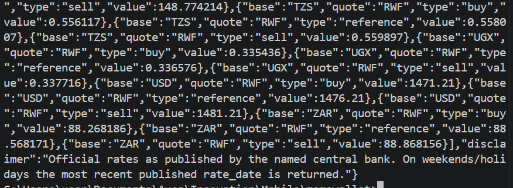
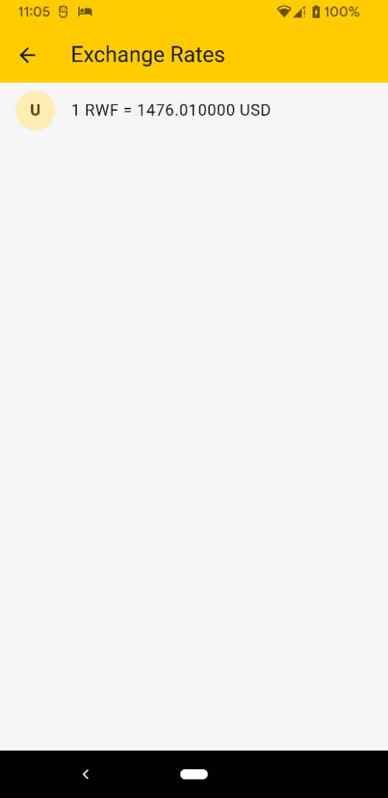

# MoMo Wallet

A Flutter wallet app that simulates MTN MoMo. Money and transactions are saved on the phone with shared_preferences so nothing is lost when the app closes. The exchange rate screen loads live National Bank of Rwanda rates from a public API.

## Screenshots

## What the app does

- Send money with phone number and amount validation
- Cash out with a note breakdown preview
- Show live exchange rates from an API
- Delete a transaction with undo
- Show an error and retry button when offline
- Save everything locally so it survives restart

## How it works

The app has two models, Transaction and Wallet. Every change to the wallet is written to SharedPreferences right away, and the app reads it back on startup or falls back to a default balance of 10,000 RWF. The rates screen calls the API with http, shows a spinner while waiting, and shows an error with a retry button if the request fails.

## How to run
Go inside foldert ,type flutter run .